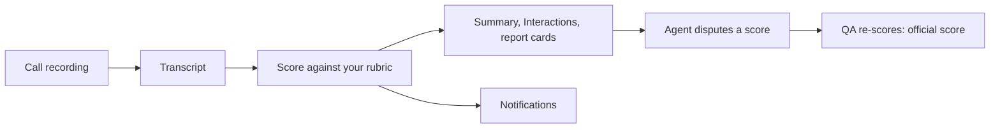

Ringg Analytics audits the calls your human agents make and take. It transcribes each call, scores it against your rubric, flags issues, and shows agents, team leads and QAs where to improve.

<Info>
  Ringg Analytics is a separate product at **[analytics.ringg.ai](https://analytics.ringg.ai)**, not part of the Ringg AI dashboard at `ringg.ai/dashboard`. It has its own sign-in: your dashboard login doesn't sign you in here, and the reverse is true too.
</Info>

<Frame caption="The Summary page for the Acme Lending workspace">
  
</Frame>

## Sign in

You join a workspace by invitation. An admin invites QAs, admins and members from **Team**, and agents and team leads from **Agents**; the invite comes by email.

<Steps>
  <Step title="Open analytics.ringg.ai">
    Enter your work email and click **Sign in**.
  </Step>
  <Step title="Enter the code">
    "Check your email": type the six-digit code from the email. There is no password.

    <Check>You land on **Summary**. If you belong to several workspaces, switch between them from the workspace menu at the top of the sidebar.</Check>
  </Step>
</Steps>

## How it works

Every call is scored against the [metrics](/analytics/set-up/metrics) of its use case: each parameter gets a rating and a reason quoting the transcript, and a missed fatal parameter sets the score to 0. QAs can [review](/analytics/review-calls/qa-reviews) any call, and agents can [dispute](/disputes/overview) a score they think is wrong.

## Get calls in

On **Interactions**, click **New**:

| Option | What it takes |
|---|---|
| **Call recordings** | `.wav` and `.mp3` audio files |
| **Bulk calls** | A CSV with a link to each recording, plus the agent's email or name |
| **Email conversations** | **Import from CSV** |
| **Video recordings** | `.mp4`, `.mov`, `.avi` and `.mkv` meeting recordings |

Only owners, admins and QAs can add calls. To let your own systems submit recordings, an admin creates a key under **Settings → API Keys → Create API key**.

## What's in Ringg Analytics

<Columns cols={2}>
  <Card title="Roles and access" icon="shield" href="/analytics/roles-and-access" horizontal>
    Who sees which calls and pages.
  </Card>
  <Card title="Summary" icon="chart-column" href="/analytics/review-calls/summary" horizontal>
    Scores and trends for your workspace, team or own calls.
  </Card>
  <Card title="Interactions" icon="inbox" href="/analytics/review-calls/interactions" horizontal>
    Every call with its transcript, recording and scorecard.
  </Card>
  <Card title="QA reviews" icon="clipboard-check" href="/analytics/review-calls/qa-reviews" horizontal>
    Re-score a call by hand next to the AI.
  </Card>
  <Card title="Report cards" icon="award" href="/analytics/coach-agents/report-cards" horizontal>
    One agent's performance, focus areas and coaching notes.
  </Card>
  <Card title="Disputes" icon="scale" href="/disputes/overview" horizontal>
    Agents appeal an AI score; a QA settles it.
  </Card>
</Columns>

## Next steps

<Columns cols={3}>
  <Card title="Metrics" icon="clipboard-list" href="/analytics/set-up/metrics">Set the rubric calls are scored against.</Card>
  <Card title="Agents and teams" icon="users" href="/analytics/coach-agents/agents-and-teams">Add agents and team leads and invite them.</Card>
  <Card title="Roles and access" icon="shield" href="/analytics/roles-and-access">Decide who sees what.</Card>
</Columns>
