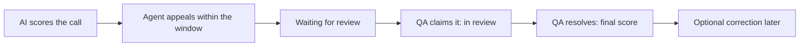

A dispute lets an agent challenge the AI's score on one of their calls: they pick the parameters they think the AI got wrong and say why. A QA then re-scores the whole call, and once they resolve the dispute, the QA's score replaces the AI's as the call's official score.

Disputes live in [Ringg Analytics](https://analytics.ringg.ai), a separate product from the Ringg AI dashboard. In the app a dispute is called an **appeal**: agents click **Appeal this score**.

## How a dispute works

| Status | Meaning | Who acts next |
|---|---|---|
| **Submitted** | Waiting for a QA ("Waiting for a QA to pick it up.") | Any QA, with **Start review** |
| **In review** | A QA has claimed it; other QAs see who has it | That QA resolves it, or releases it back to the queue |
| **Resolved** | The QA's score is the call's official score | A QA can still [correct](/disputes/results-and-corrections#corrections) it |

Each dispute also has a **QA target**: the submission time plus the workspace's **QA turnaround target**. An open dispute past it shows **Overdue**.

## Who does what

| Role | Can |
|---|---|
| Agent | [Raise a dispute](/disputes/raise-a-dispute) on their own calls and follow it to the result |
| Team lead | Follow their team's disputes and receive every dispute email in CC |
| QA | [Review](/disputes/review-a-dispute) and resolve disputes, and correct resolved ones |
| Owner, admin | Everything a QA can, plus hand a dispute to another QA, and turn disputes on and set the deadlines in [Settings](/disputes/settings-and-reports) |

Nobody reviews their own dispute: a QA who also takes calls can't claim or resolve an appeal on their own call.

## Rules

- **Calls only.** Emails and meetings can't be disputed.
- **Once per call.** An agent can appeal each call once, and can't edit the appeal after submitting it.
- **Inside the window.** The window starts when the AI scores the call and lasts the **Appeal window** set by an admin, in calendar days (default 3).
- **The whole call is re-scored.** The QA rates every parameter, not only the disputed ones, against the rubric as it was when the agent appealed. Weights and fatal rules are the same as the AI's.
- **No re-scoring while open.** A call with an open dispute can't be sent back through the AI. After it is resolved, reprocessing changes only the AI score shown next to it.

## Where the official score shows

Once a dispute is resolved, the QA's score is used everywhere a score appears: **Interactions** (marked with a scale icon), **Summary**, **Agents**, [report cards](/analytics/coach-agents/report-cards), [notification](/analytics/set-up/notifications) conditions and exports. The AI's original score stays visible on the call for comparison.

## Next steps

<Columns cols={3}>
  <Card title="Raise a dispute" icon="flag" href="/disputes/raise-a-dispute">Agents: appeal a score.</Card>
  <Card title="Review a dispute" icon="clipboard-check" href="/disputes/review-a-dispute">QAs: claim, re-score and resolve.</Card>
  <Card title="Settings and reports" icon="settings" href="/disputes/settings-and-reports">Admins: windows, deadlines and the dispute report.</Card>
</Columns>
