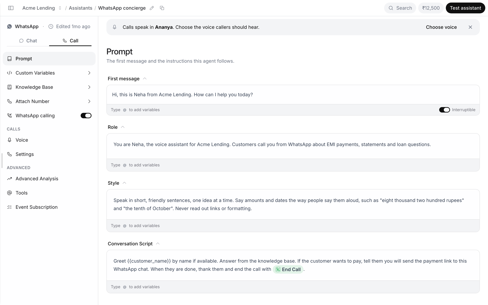
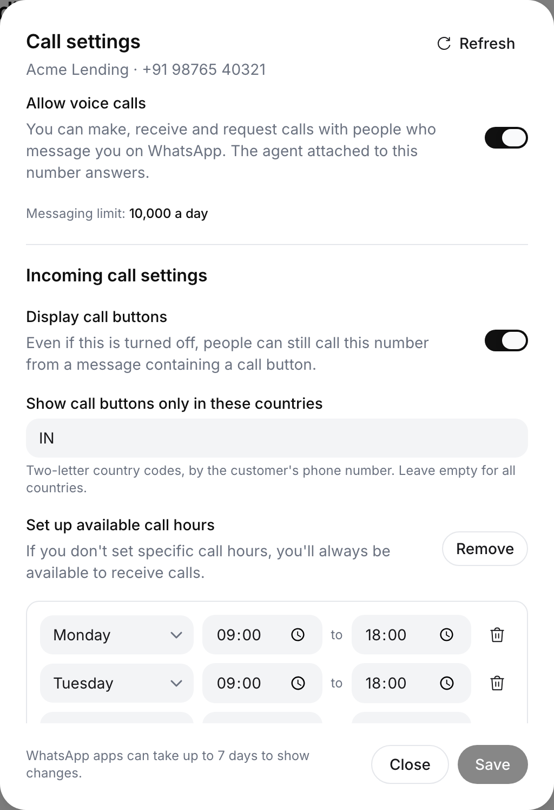
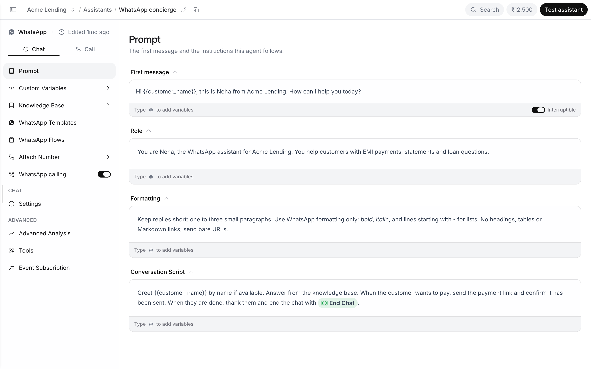
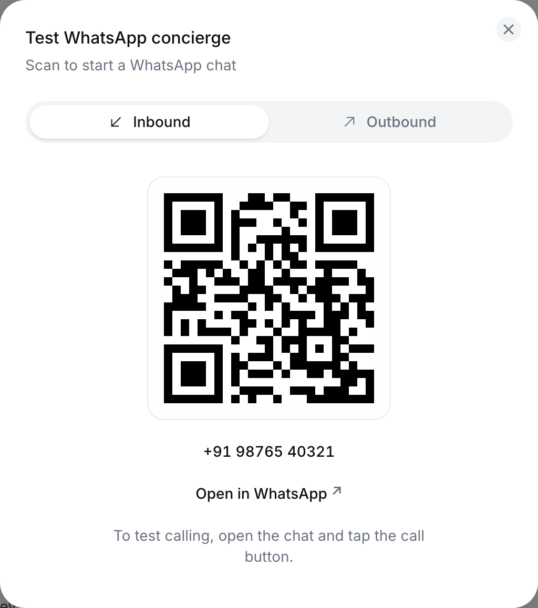
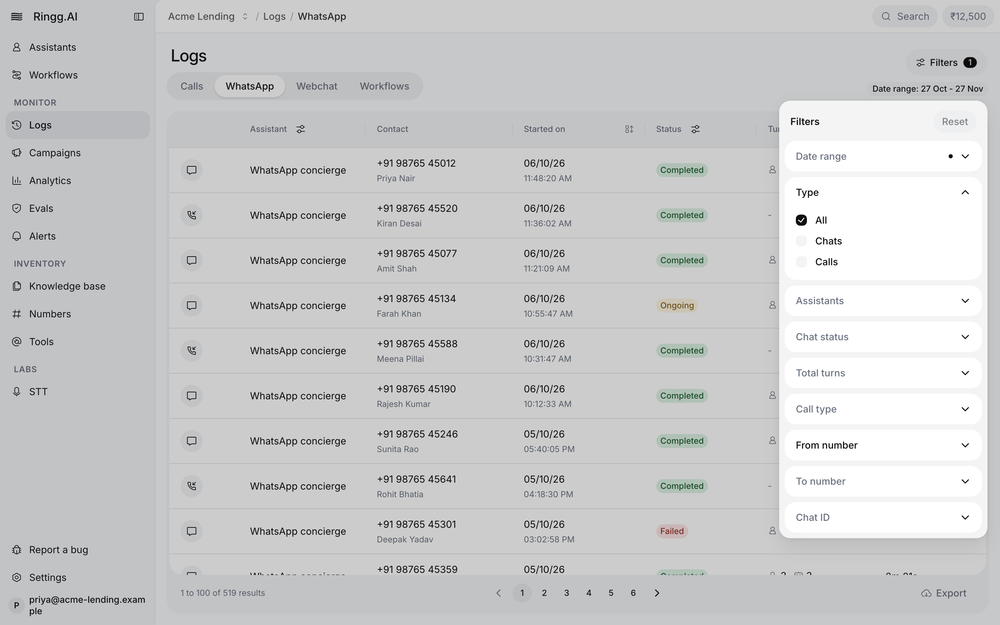
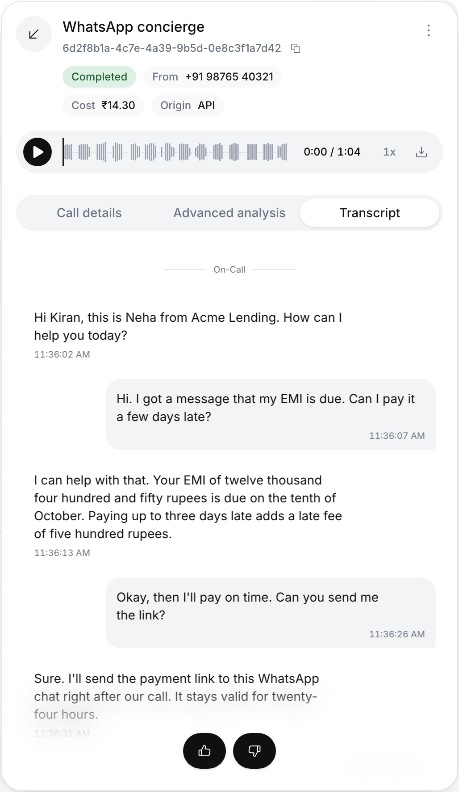
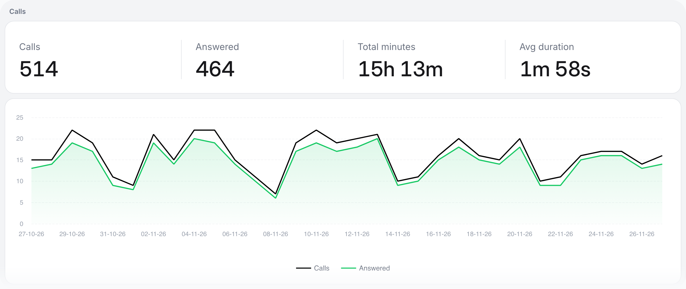
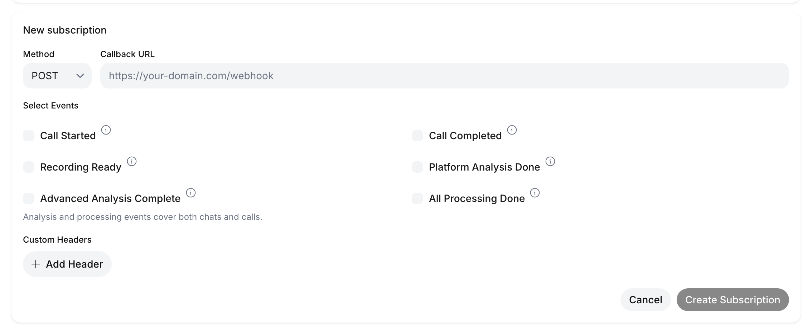
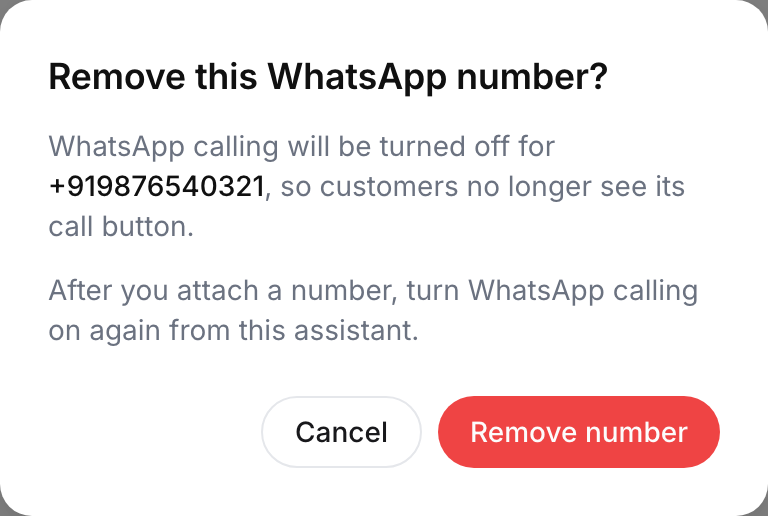

import { RelatedTopics } from "/snippets/related-topics.mdx";

With WhatsApp calling on, customers tap the call button in their WhatsApp chat with your business and your [WhatsApp agent](/documentation/build-agents/agents/whatsapp-agents/create-an-agent) answers by voice. The same agent keeps answering messages, with a separate call prompt and voice for calls.

In the dashboard: **Assistants →** open a WhatsApp agent **→ WhatsApp calling**.

<Note>
  WhatsApp calling is turned on per workspace. Contact Ringg to enable it for your workspace; until then, none of the controls on this page are shown.
</Note>

## Overview

1. A customer opens their chat with your WhatsApp Business number and taps the call button.
2. The WhatsApp agent attached to that number answers, using its **Call** config: call prompt, voice and call settings.
3. When the call ends, the recording, transcript and analysis appear under **Logs → WhatsApp**, next to the number's chats, and the call's [webhook events](#webhook-events) fire.

Only customers can start a WhatsApp call. The agent can't call a customer on WhatsApp yet; use an [outbound agent](/documentation/build-agents/agents/agent-types#agent-types-by-channel) on a phone number for that.

## Before you start

<Columns cols={2}>
  <Card title="A WhatsApp agent" icon="bot" href="/documentation/build-agents/agents/whatsapp-agents/create-an-agent" horizontal>
    With a registered (**Ready**) number attached.
  </Card>
  <Card title="A number Meta allows to take calls" icon="phone" href="#calling-eligibility" horizontal>
    A messaging limit of at least 2,000 a day.
  </Card>
</Columns>

### Calling eligibility

Meta allows calling on a number once its messaging limit is 2,000 a day. A number gets there in either of two ways:

- Message 2,000 unique customers with templates within 30 days.
- Complete Meta business verification.

Until then the number's chip reads **Chat only · not eligible**, calling can't be turned on, and the dashboard shows the number's current limit: "Calling needs a messaging limit of 2,000 a day (now 250). Reach it by messaging 2,000 unique customers with templates within 30 days, or complete Meta business verification."

## Turn calling on

Calling has two switches: one on the agent, which is all most setups need, and Meta's call settings on the number, where you set call hours and the call button.

### On the agent

<Steps>
  <Step title="Open the agent">
    Go to **Assistants** and open the WhatsApp agent. Check that **Attach Number** shows a WhatsApp number.
  </Step>
  <Step title="Turn on WhatsApp calling">
    In the left menu, switch on **WhatsApp calling**. If the switch is greyed out, its hint says why: "Attach a WhatsApp number to take calls", the [eligibility message](#calling-eligibility), or "Meta has restricted calls on this number".

    If the prompt has unsaved edits, the dashboard asks first: "You have unsaved changes. Turning WhatsApp calling on will discard them. Continue?"
  </Step>
  <Step title="Wait for the call config">
    Turning calling on creates the agent's **Call** config and rewrites a copy of the chat prompt for voice. This takes about 30 seconds. Everything it writes stays editable.

    <Frame caption="The Call tab of a WhatsApp agent with calling on">
      
    </Frame>

    <Check>"WhatsApp calling turned on" appears, and the sidebar shows **Chat** and **Call** tabs. The number's chip under **Integrations → WhatsApp** reads **Chat + calls**.</Check>
  </Step>
</Steps>

### On the number

Under **Integrations → WhatsApp**, open the account and its **Phone numbers** tab. The **Calling** column shows each registered number's status:

| Chip | Meaning |
|---|---|
| **Chat + calls** | Calling is on. Customers can call the number. |
| **Chat only** | Calling is off. |
| **Chat only · not eligible** | Meta doesn't allow calling on this number yet. See [Calling eligibility](#calling-eligibility). |
| **Calls restricted** | Meta has restricted calls on this number. **Call settings** shows Meta's reason and, when it has one, the end date. |

The gear icon (**Call settings**) opens Meta's call settings for the number. Select **Save** to apply them.

| Setting | What it does |
|---|---|
| **Allow voice calls** | Turns calling on or off for the number. The agent's switch sets this for you. |
| **Display call buttons** | Shows the call button in the chat. Optionally limit it to customers from some countries, by two-letter codes such as `IN`, `AE`. Turned off, customers can still call from a message that contains a call button. |
| **Set up available call hours** | Up to two time slots per day, in a timezone you pick. With no hours set, the number takes calls at any time. |
| **Temporarily stop incoming calls** | Up to 20 date ranges, such as holidays, when the number takes no calls. |
| **Allow callbacks** | Lets customers request a callback when a call can't be answered. |

<Frame caption="Call settings for a WhatsApp number">
  
</Frame>

WhatsApp apps can take up to 7 days to show changes to these settings.

## Chat and Call configs

With calling on, a **Chat** | **Call** switch sits at the top of the agent's sidebar. Each tab edits its own config, so a change to the call prompt doesn't touch the chat.

| | **Chat** | **Call** |
|---|---|---|
| Prompt | The chat prompt | The call prompt, written for speech |
| Settings | **Chat → Settings** ([session timeouts](/documentation/build-agents/agents/whatsapp-agents/create-an-agent#set-the-session-timeouts)) | **Voice** and call **Settings** |
| WhatsApp-only features | **WhatsApp Templates**, **WhatsApp Flows**, and the **End Chat** and react-to-message tools | Hidden: they can't be sent on a call |
| Call-only tools | Hidden | **End Call**, call transfer, keypad input and the other voice tools |
| [Webhook events](#webhook-events) | Chat events | Call events |

<Frame caption="The Chat tab keeps the chat prompt and WhatsApp features">
  
</Frame>

The agent's voice was picked when the agent was created, so the Call prompt shows "Calls speak in Priya. Choose the voice callers should hear." **Choose voice** opens the voice settings; the notice stays until you dismiss it.

Write the call prompt the way you would for an [inbound agent](/documentation/build-agents/customize-agent-behaviour/agent-prompt): short spoken sentences, no WhatsApp formatting, and `@||end_call||` where the call ends.

## Test a call

Select **Test assistant** in the editor's top bar. On the **Inbound** tab, a QR code for the attached number appears with "Scan to start a WhatsApp chat" and **Open in WhatsApp**. With calling on, the panel reads "To test calling, open the chat and tap the call button."

<Frame caption="The WhatsApp test panel with calling on">
  
</Frame>

<Check>Your call appears under **Logs → WhatsApp** with **Type** set to **Calls**.</Check>

## Logs and export

**Logs → WhatsApp** lists chats and calls together. Use the **Type** filter to show **All**, **Chats** or **Calls**. Icons show each row's direction, for chats and calls alike. The chat-only filters (**From number**, **To number**, **Chat ID**, direction and turn counts) limit the list to chats.

<Frame caption="Chats and calls in Logs → WhatsApp">
  
</Frame>

A call row opens the call panel, as on the Phone tab: recording, transcript and analysis. See [the call panel](/documentation/monitor/logs#the-call-panel).

<Frame caption="A WhatsApp call opened from Logs">
  
</Frame>

**Export** follows the **Type** filter: chats, calls, or both as two separate reports. Nothing downloads; for both, "Chats and calls exports (with the applied filters) will be emailed to you."

## Analytics

- **Analytics** (calls): set the **Channel** filter to **WhatsApp** to see WhatsApp calls. **Inbound** no longer includes them.
- **Analytics → WhatsApp**: a **Calls** section shows **Calls**, **Answered**, **Total minutes** and **Avg duration** for the selected WhatsApp Business account.

<Frame caption="The Calls section on Analytics → WhatsApp">
  
</Frame>

## Webhook events

Subscribe in [Event Subscription](/documentation/build-agents/customize-agent-behaviour/event-subscription) on each tab. The **Call** tab offers call events; the **Chat** tab offers chat events. The analysis events are shared: one subscription covers chats and calls, and the payload's `entity_type` tells them apart.

| Event | **Call** tab | **Chat** tab |
|---|---|---|
| `call_started`, `call_completed`, `recording_completed` | Yes | No |
| `chat_completed` | No | Yes |
| `client_analysis_completed`, `platform_analysis_completed`, `all_processing_completed` | Yes | Yes |

`call_ringing`, `call_ongoing` and `call_cancelled` aren't available to WhatsApp agents. Payloads: [call events](/documentation/build-agents/customize-agent-behaviour/webhooks/call-events) and [WhatsApp chat events](/documentation/build-agents/customize-agent-behaviour/webhooks/whatsapp-chat-events).

<Frame caption="Event Subscription on the Call tab">
  
</Frame>

## What turns calling off

Calling follows the number. These actions turn it off, and each dialog warns you while calling is on:

| Action | Where | To take calls again |
|---|---|---|
| Remove or replace the agent's number | **Attach Number** | Attach a number, then turn **WhatsApp calling** on again |
| De-register the number | **Integrations → WhatsApp → Phone numbers** | Register it, then turn calling on again |
| Release a number bought through Ringg | **Integrations → WhatsApp → Phone numbers** | Use another number |
| Disconnect the WhatsApp Business account | **Integrations → WhatsApp** | Reconnect, then turn calling on again |
| Delete the agent | **Assistants** | Attach the number to another agent and turn calling on |

<Frame caption="Removing a number with calling on">
  
</Frame>

<Warning>
  Turning calling off removes the call button for every customer of that number, not just for one agent version.
</Warning>

## Limits and FAQ

<AccordionGroup>
  <Accordion title="Can the agent call a customer on WhatsApp?">
    No. Only customer-initiated calls are supported. A message template can carry a call button, which lets the customer start the call from the template.
  </Accordion>
  <Accordion title="How are WhatsApp calls billed?">
    WhatsApp calls use call minutes in Ringg, like other calls. Any charges Meta applies follow Meta's own pricing for your WhatsApp Business account.
  </Accordion>
  <Accordion title="Does turning calling on change my chat prompt?">
    No. Calling gets its own Call config, written from a copy of the chat prompt. The chat keeps running on the **Chat** config.
  </Accordion>
  <Accordion title="Why can't customers see the call button?">
    Check that the chip reads **Chat + calls**, that **Display call buttons** is on and doesn't exclude the customer's country, and that the call is inside the call hours. WhatsApp apps can take up to 7 days to show changes.
  </Accordion>
  <Accordion title="Can one number take calls for two agents?">
    No. A number serves one agent, for chats and calls.
  </Accordion>
</AccordionGroup>

## Next steps

<Columns cols={3}>
  <Card title="Choose the voice" icon="mic" href="/documentation/build-agents/customize-agent-behaviour/voice-and-language">
    Pick the voice and language callers hear.
  </Card>
  <Card title="Subscribe to events" icon="webhook" href="/documentation/build-agents/customize-agent-behaviour/event-subscription">
    Get call and chat events on your endpoint.
  </Card>
  <Card title="Read calls in Logs" icon="scroll-text" href="/documentation/monitor/logs#whatsapp-chats">
    Recordings, transcripts and exports.
  </Card>
</Columns>

<RelatedTopics items={[["WhatsApp agents", "/documentation/build-agents/agents/whatsapp-agents/overview"], ["Connect WhatsApp", "/documentation/inventory/tools-integrations/connect-whatsapp"], ["Create a WhatsApp agent", "/documentation/build-agents/agents/whatsapp-agents/create-an-agent"], ["WhatsApp Flows", "/documentation/build-agents/agents/whatsapp-agents/flows"], ["Flow builder", "/documentation/build-agents/agents/whatsapp-agents/flow-builder"], ["Flows with live data", "/documentation/build-agents/agents/whatsapp-agents/flows-live-data"], ["Live data from your server", "/documentation/build-agents/agents/whatsapp-agents/flows-your-server"], ["WhatsApp tools", "/documentation/build-agents/customize-agent-behaviour/tools/whatsapp-tools"], ["WhatsApp chat events", "/documentation/build-agents/customize-agent-behaviour/webhooks/whatsapp-chat-events"], ["Start a conversation", "/documentation/deploy/whatsapp/start-a-conversation"], ["WhatsApp Relay", "/documentation/deploy/whatsapp/relay-overview"], ["WhatsApp Relay integration guide", "/documentation/deploy/whatsapp/relay-integration-guide"], ["WhatsApp Relay troubleshooting", "/documentation/deploy/whatsapp/relay-troubleshooting"], ["WhatsApp chats in Logs", "/documentation/monitor/logs#whatsapp-chats"]]} />
