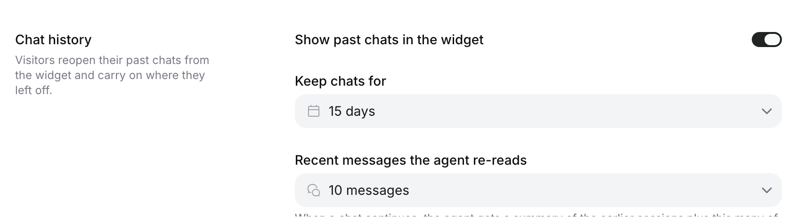
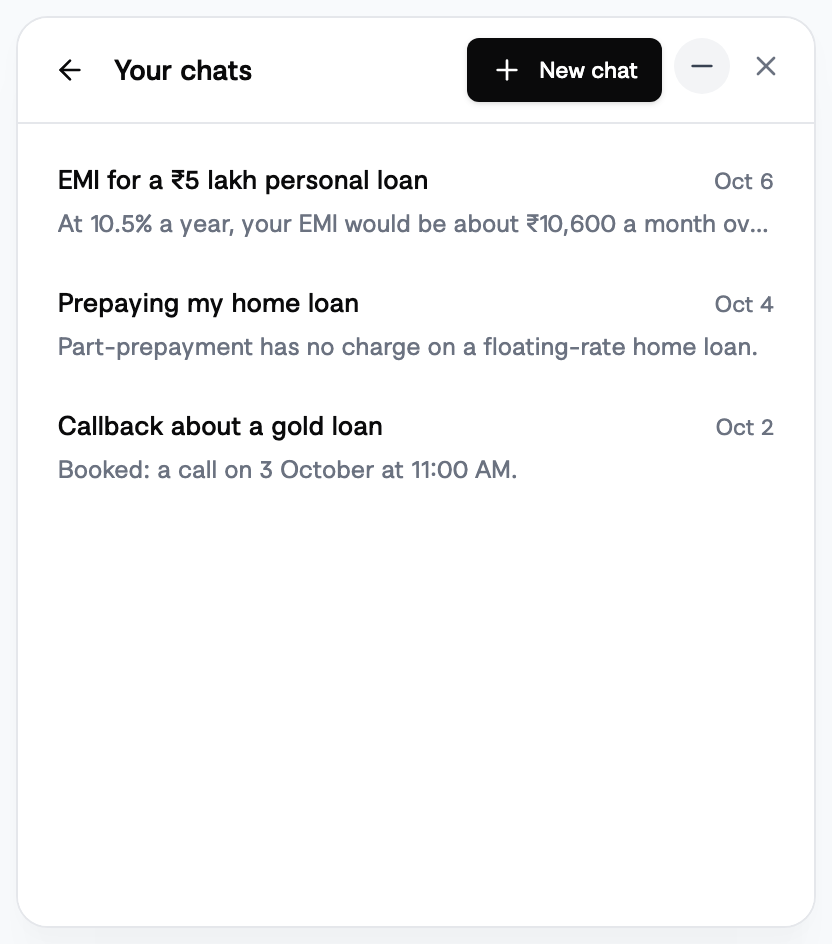
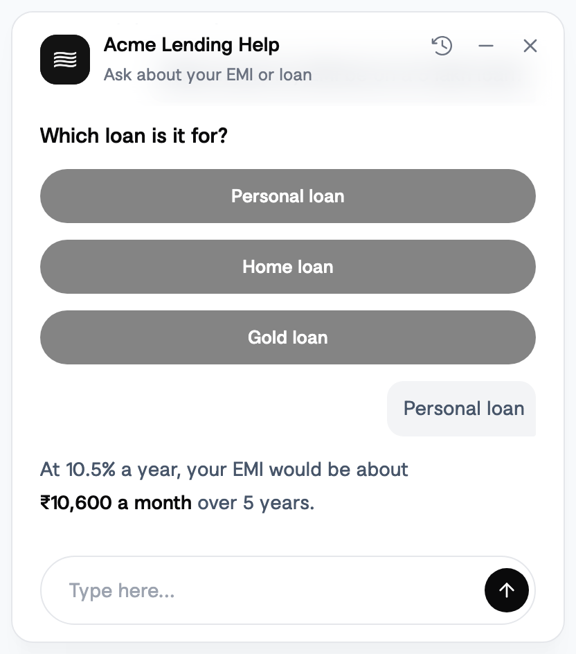

Chat history adds a **History** button to the [web widget](/documentation/deploy/web-and-apps/web-widget/overview). A visitor reopens a past chat, sees it as it was, and carries on: the agent remembers what was said and picks up where the chat stopped. It is off by default and set per agent.

In the dashboard: **Sidebar → Assistants →** open an agent **→ Chat**.

## Before you start

<Columns cols={2}>
  <Card title="A widget in chat mode" icon="message-square" href="/documentation/deploy/web-and-apps/web-widget/chat-mode" horizontal>
    History lists text chats only.
  </Card>
  <Card title="The widget on your site" icon="globe" href="/documentation/deploy/web-and-apps/web-widget/overview" horizontal>
    No code change: the widget handles history itself.
  </Card>
</Columns>

## Turn on chat history

The video shows the setting, then a visitor reopening a chat on a site.

<Frame caption="Turning on chat history, then reopening a past chat from the widget">
  <video alt="Turning on chat history, then reopening a past chat from the widget" aria-label="Turning on chat history, then reopening a past chat from the widget" controls muted playsInline className="w-full rounded-xl" style={{ aspectRatio: "16 / 10" }} preload="metadata" controlsList="nodownload noremoteplayback" poster="/media/webchat-history/poster.webp">
    <source src="/media/webchat-history/video.webm" type='video/webm; codecs="av01.0.09M.08"' />
  </video>
</Frame>

<Steps>
  <Step title="Open the agent's chat settings">
    Open the agent and select **Chat**.
  </Step>
  <Step title="Turn on Show past chats in the widget">
    Under **Chat history**, turn on **Show past chats in the widget**. Two settings appear:

    | Setting | What it does | Options |
    |---|---|---|
    | **Keep chats for** | How long after its last message a chat stays in History and can be continued. | 1, 3, 7 or 15 days. Default 15. |
    | **Recent messages the agent re-reads** | How many of the latest messages the agent gets word for word when a chat continues. It also gets a summary of the earlier sessions. | 0, 5, 10, 20, 30 or 50. Default 10. |

    <Frame caption="The Chat history settings of an agent">
      
    </Frame>
  </Step>
  <Step title="Chat on your site">
    Open the widget, send a message and close the chat. Open the widget again.

    <Check>The widget shows a **History** button. It lists the chat you just had.</Check>
  </Step>
</Steps>

## What visitors see

The **History** button appears once the visitor has at least one chat with this agent, so a first visit never shows an empty list. It is not shown during a voice call or on a call-only widget.

<Columns cols={2}>
  <Frame caption="Your chats: past chats, latest first">
    
  </Frame>
  <Frame caption="A reopened chat, its widget included">
    
  </Frame>
</Columns>

- **The list** names each chat by its title from post-call analysis, or its first message until that is ready, with the last message and the date. A chat where the visitor never typed or tapped anything is not listed. **New chat** starts a fresh one.
- **A reopened chat** shows every message, and components such as forms and buttons are drawn as they looked but can't be used again. One exception: if the last thing in the chat is an unanswered set of buttons, the visitor can still tap one, and the tap is sent as their next message.
- **Carrying on** starts when the visitor types. The agent does not greet again; it gets a summary of the earlier sessions plus the latest messages, and a [multi-prompt agent](/documentation/build-agents/agents/agent-types) resumes at the step the chat stopped on. If that step was removed or can't be resumed, such as a router, it starts from the first step.
- **Switching chats** during a live chat ends the live one first.

A chat that can't be continued, because it is older than **Keep chats for** or history was turned off, shows "This chat can no longer be continued." and offers **New chat**.

## How chats are kept

- **Per browser.** The widget gives each browser a random ID, kept in its local storage, and lists only that browser's chats. Another browser or device starts with an empty History. If the browser blocks storage, the ID lasts only for the page. Nothing in the ID identifies the visitor.
- **Per agent.** History lists chats with the agent on that widget.
- **One chat, several sessions.** Each time a visitor continues a chat, the widget opens a new session. Every session is its own call record, billed and analysed on its own, and the chat ties them together under one `conversation_id`: the first session's call ID. Every session's `all_processing_completed` webhook carries it as [`conversation_id`](/documentation/build-agents/customize-agent-behaviour/webhooks/field-reference).
- **In Logs**, the **Webchat** tab shows one row per chat with its totals across sessions. See [Web chats in Logs](/documentation/monitor/logs#web-chats).

## Next steps

<Columns cols={3}>
  <Card title="Web chats in Logs" icon="history" href="/documentation/monitor/logs#web-chats">
    Read a chat across all its sessions.
  </Card>
  <Card title="Build a component" icon="blocks" href="/documentation/deploy/web-and-apps/web-widget/components">
    Forms and pickers that reappear in reopened chats.
  </Card>
  <Card title="Prepare for launch" icon="shield-check" href="/documentation/deploy/web-and-apps/web-widget/launch-checklist">
    Domains, version pinning and browser QA.
  </Card>
</Columns>
